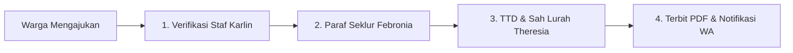

# BUKU PANDUAN PENGGUNAAN (USER MANUAL)
## SISTEM INFORMASI & PORTAL E-MONOGRAFI KELURAHAN KOLONGAN SATU
### Pemerintah Kota Tomohon • Kecamatan Tomohon Tengah • Kelurahan Kolongan Satu

---

* **Nomor Dokumen:** MANUAL/KKT/2026/V1  
* **Versi Rilis:** 1.0.0 (Production Edition)  
* **Tahun Berlaku:** 2026  
* **Alamat Website Resmi:** [https://kolongansatu.site](https://kolongansatu.site)  
* **Portal Administrasi Aparatur:** [https://kolongansatu.site/portal](https://kolongansatu.site/portal)  

---

## DAFTAR ISI

1. [BAB I : PENDAHULUAN & GAMBARAN UMUM SISTEM](#bab-i--pendahuluan--gambaran-umum-sistem)
   * 1.1 Latar Belakang & Tujuan
   * 1.2 Struktur Arsitektur Platform
   * 1.3 Hak Akses & Pembagian Peran Pengguna (*Role Matrix*)
2. [BAB II : PANDUAN WARGA MASYARAKAT (PORTAL PUBLIK)](#bab-ii--panduan-warga-masyarakat-portal-publik)
   * 2.1 Menjelajahi Profil & Informasi Kelurahan
   * 2.2 Peta Fasilitas & Geospasial 5 Lingkungan Jaga
   * 2.3 Layanan Pengajuan Surat Mandiri Warga
   * 2.4 Pelacakan Status Surat Masuk via Nomor Resi
   * 2.5 Kotak Pengaduan & Aspirasi Lingkungan Warga (`/lapor`)
   * 2.6 Portal Transparansi e-Monografi Publik
3. [BAB III : PANDUAN AUTENTIKASI & KEAMANAN PORTAL APARATUR](#bab-iii--panduan-autentikasi--keamanan-portal-aparatur)
   * 3.1 Prosedur Masuk (*Login*) Aparatur
   * 3.2 Daftar Kredensial Resmi Kedinasan
   * 3.3 Sistem Pengamanan Brute-Force & Pembatasan Upaya Gagal
   * 3.4 Prosedur Pemulihan Kata Sandi (*Self-Service Reset Password*)
4. [BAB IV : PANDUAN OPERASIONAL E-MONOGRAFI DIGITAL](#bab-iv--panduan-operasional-e-monografi-digital)
   * 4.1 Pemilihan Periode & Pembukaan Tahun Baru
   * 4.2 Struktur Bab Monografi (Demografi, Teritorial, Lingkungan)
   * 4.3 Formulir Pengisian & Agregasi Data Otomatis
   * 4.4 Alur Validasi Berjenjang: Paraf Seklur & Pengesahan Mutlak Lurah
   * 4.5 Pratinjau Grafik Visual & Cetak Lembar Monografi Resmi
5. [BAB V : PANDUAN MODUL REKAP & PENERBITAN SURAT RESMI (PDF)](#bab-v--panduan-modul-rekap--penerbitan-surat-resmi-pdf)
   * 5.1 Pipeline 4 Tahapan Persuratan Dinas
   * 5.2 Verifikasi Berkas Fisik & Kelayakan (Staf Karlin)
   * 5.3 Koreksi Administrasi & Paraf Digital (Seklur Febronia)
   * 5.4 Penandatanganan & Pengesahan Resmi (Lurah Theresia)
   * 5.5 Integrasi Notifikasi Resmi ke WhatsApp Pemohon
   * 5.6 Penerbitan & Pengunduhan Dokumen PDF Ber-QR Code
6. [BAB VI : PANDUAN KOTAK PENGADUAN & ASPIRASI WARGA](#bab-vi--panduan-kotak-pengaduan--aspirasi-warga)
   * 6.1 Manajemen Tiket Pengaduan per Lingkungan Jaga
   * 6.2 Filter Pipeline & Pencarian Cepat Laporan
   * 6.3 Pemberian Tanggapan & Penugasan Tindakan Lapangan
   * 6.4 Pengiriman Pemberitahuan Solusi ke WhatsApp Pelapor
7. [BAB VII : PANDUAN PENGELOLAAN KONTEN WEBSITE (CMS PORTAL)](#bab-vii--panduan-pengelolaan-konten-website-cms-portal)
   * 7.1 Kelola Fasilitas Publik & Metrik Sanitasi
   * 7.2 Kelola Struktur Organisasi Aparatur
   * 7.3 Kelola Dokumentasi & Publikasi Berita Kegiatan
   * 7.4 Kelola Kontak Resmi & Jam Pelayanan Kantor
8. [BAB VIII : TANYA JAWAB (FAQ) & DUKUNGAN TEKNIS](#bab-viii--tanya-jawab-faq--dukungan-teknis)

---

## BAB I : PENDAHULUAN & GAMBARAN UMUM SISTEM

### 1.1 Latar Belakang & Tujuan
Sistem Informasi dan Portal e-Monografi Kelurahan Kolongan Satu merupakan platform digital terpadu Pemerintah Kelurahan Kolongan Satu, Kecamatan Tomohon Tengah, Kota Tomohon, Sulawesi Utara. Platform ini dibangun untuk mentransformasikan tata kelola pemerintahan kelurahan dari pencatatan konvensional menjadi ekosistem digital berbasis awan (*cloud-native*) yang transparan, akuntabel, dan berorientasi pada pelayanan masyarakat prima.

Tujuan utama sistem ini:
1. **Transparansi Data:** Menyajikan data statistik demografi, sosial, dan kewilayahan yang tervalidasi secara *real-time*.
2. **Efisiensi Pelayanan Publik:** Mempermudah warga dalam mengajukan permohonan surat dinas dan pengaduan lingkungan secara mandiri.
3. **Tertib Administrasi Berjenjang:** Menerapkan alur persetujuan surat dan monografi berjenjang mulai dari Staf $\rightarrow$ Sekretaris Kelurahan $\rightarrow$ Lurah.
4. **Keamanan & Keabsahan Hukum:** Dokumen terbitan dilengkapi stempel digital dan verifikasi QR Code resmi berstandar Balai Sertifikasi Elektronik (BSrE).

### 1.2 Struktur Arsitektur Platform
Platform terbagi menjadi dua bagian utama:
1. **Portal Publik (`https://kolongansatu.site`)**: Dapat diakses bebas oleh seluruh warga dan masyarakat umum tanpa perlu masuk/login.
2. **Portal Aparatur (`https://kolongansatu.site/portal`)**: Area kerja terproteksi khusus untuk aparatur kelurahan dan Kepala Lingkungan (Pala) yang dilindungi sistem autentikasi Supabase.

### 1.3 Hak Akses & Pembagian Peran Pengguna (*Role Matrix*)

| Peran (*Role*) | Pejabat / Pengguna | Hak Akses Utama |
| :--- | :--- | :--- |
| **Lurah (Superadmin)** | Theresia J. Kaunang, SE | • Otoritas mutlak pengesahan data Monografi tahunan • Penandatanganan digital akhir & pengesahan dokumen surat PDF resmi • Pemantauan penuh seluruh modul & kontrol akses |
| **Sekretaris Kelurahan (Admin Utama)** | Febronia L. Pijoh, S.Kom | • Verifikasi administratif & paraf data monografi kelurahan • Pembubuhan paraf surat dinas sebelum diajukan ke Lurah • Pengelolaan konten website (CMS kegiatan, fasilitas, kontak) • Pembukaan periode buku tahunan baru |
| **Pelaksana Administrasi / Staf** | Karlin S. Pieter | • Pemeriksaan kelengkapan berkas fisik & KTP/KK pemohon surat • Verifikasi awal permohonan surat masuk • Penginputan data monografi lapangan |
| **Kepala Seksi (Kasie)** | Kasie Pem, Kasie Kesra, Kasie Bang | • Penginputan & pembaruan indikator data sektoral sesuai bidang tugas masing-masing |
| **Warga Masyarakat** | Masyarakat Umum | • Pengajuan surat permohonan mandiri & cek resi • Pengiriman laporan aduan lingkungan 5 Jaga • Meninjau data monografi publik & fasilitas kelurahan |

---

## BAB II : PANDUAN WARGA MASYARAKAT (PORTAL PUBLIK)

### 2.1 Menjelajahi Profil & Informasi Kelurahan
1. Buka peramban (*browser*) dan ketik alamat: **`https://kolongansatu.site`**.
2. Di halaman utama, warga dapat melihat:
   * **Hero Beranda:** Sambutan resmi pimpinan, jam kerja pelayanan, dan tautan pintas layanan unggulan.
   * **Sejarah & Profil Teritorial:** Sejarah pembentukan Kelurahan Kolongan Satu, visi-misi, dan batas wilayah.
   * **Ringkasan Monografi Kependudukan:** Statistik jumlah penduduk pria, wanita, kepala keluarga, dan hak pilih aktif.

### 2.2 Peta Fasilitas & Geospasial 5 Lingkungan Jaga
1. Gulir ke bagian **"Fasilitas Publik & Lingkungan"**.
2. Warga dapat mengklik tab Lingkungan I s.d. Lingkungan V (Jaga 1 s.d. 5) untuk melihat daftar sarana ibadah, balai kelurahan, posyandu, instalasi air bersih, dan infrastruktur umum.

### 2.3 Layanan Pengajuan Surat Mandiri Warga
Warga dapat mengajukan permohonan surat dinas resmi tanpa antre di kantor kelurahan:
1. Klik tombol **"Layanan Persuratan"** pada menu navigasi utama.
2. Pilih jenis surat yang dibutuhkan:
   * Surat Keterangan Usaha (SKU)
   * Surat Keterangan Catatan Kepolisian (Pengantar SKCK)
   * Surat Keterangan Tidak Mampu (SKTM)
   * Surat Keterangan Domisili
   * Surat Keterangan Kelahiran / Kematian / Belum Menikah
3. Isi formulir permohonan:
   * **Nama Lengkap** & **NIK (16 Digit)**
   * **Nomor WhatsApp Aktif** (digunakan untuk menerima notifikasi status berkas)
   * **Lingkungan Jaga** tempat domisili (Jaga I - V)
   * **Keperluan Surat** (tujuan penggunaan dokumen)
   * **Unggah Lampiran Berkas** (Foto KTP / Kartu Keluarga)
4. Klik tombol **"Kirim Permohonan Surat"**.
5. Sistem akan menampilkan **Nomor Registrasi / Resi** (contoh: `REG-SKU-202610-001`). Simpan atau catat nomor resi ini.

### 2.4 Pelacakan Status Surat Masuk via Nomor Resi
1. Pada modal layanan persuratan, pilih tab **"Lacak Status Surat"**.
2. Masukkan **Nomor Registrasi** Anda pada kolom pencarian.
3. Sistem akan menampilkan tahapan proses secara *real-time*:
   * `Diajukan Warga` $\rightarrow$ Berkas masuk antrean loket digital kelurahan.
   * `Diverifikasi Staf` $\rightarrow$ Persyaratan KTP/KK telah diperiksa Staf Karlin.
   * `Diparaf Seklur` $\rightarrow$ Redaksi surat telah diparaf Sekretaris Kelurahan.
   * `Selesai & Disahkan Lurah` $\rightarrow$ Surat telah ditandatangani Lurah Theresia dan berkas PDF ber-QR Code siap diunduh.

### 2.5 Kotak Pengaduan & Aspirasi Lingkungan Warga (`/lapor`)
Warga yang menemukan permasalahan fasilitas publik (jalan berlubang, pipa air bersih bocor, penumpukan sampah, atau ketertiban lingkungan) dapat melapor secara langsung:
1. Buka menu **"Kotak Aduan Warga"** atau akses langsung **`https://kolongansatu.site/lapor`**.
2. Pilih **Kategori Masalah** (Infrastruktur Jalan, Air Bersih, Drainase, Kebersihan, Keamanan, dsb.).
3. Pilih **Lingkungan Jaga** terjadinya masalah (Jaga I s.d. V).
4. Tuliskan deskripsi permasalahan secara jelas dan sertakan patokan lokasi.
5. Masukkan nama dan nomor kontak WhatsApp.
6. *(Opsional)* Unggah foto bukti kondisi lapangan.
7. Klik **"Kirim Laporan Pengaduan"**. Anda akan menerima nomor tiket pelaporan.

### 2.6 Portal Transparansi e-Monografi Publik
1. Akses menu **"Monografi"** atau buka **`https://kolongansatu.site/monografi`**.
2. Warga dapat melihat ringkasan buku data kelurahan resmi yang telah disahkan oleh Lurah, mencakup komposisi piramida penduduk, distribusi per jaga, serta capaian pembangunan kelurahan.

---

## BAB III : PANDUAN AUTENTIKASI & KEAMANAN PORTAL APARATUR

### 3.1 Prosedur Masuk (*Login*) Aparatur
1. Akses halaman login resmi di: **`https://kolongansatu.site/portal/login`**.
2. Masukkan **NIP** atau **Email Kedinasan** pada kolom pertama.
3. Masukkan **Kata Sandi Kedinasan** pada kolom kedua.
4. Klik tombol **"Masuk ke Portal e-Monografi"**.
5. Sistem akan memverifikasi token sesi melalui Supabase Security dan mengarahkan aparatur ke ruang kerja dashboard `/portal`.

### 3.2 Daftar Kredensial Resmi Kedinasan

> [!IMPORTANT]
> Jagalah kerahasiaan kata sandi kedinasan Anda. Jangan membagikan kata sandi kepada pihak yang tidak berkepentingan.

| Pejabat / Peran | NIP Resmi | Email Resmi | Kata Sandi Bawaan | Hak Akses |
| :--- | :--- | :--- | :--- | :--- |
| **Theresia J. Kaunang, SE** *(Lurah / Superadmin)* | `19731206 200312 2 007` | `lurah@kolongansatu.tomohon.go.id` | `LurahKKT#2026` | Pengesahan akhir monografi & TTD surat dinas PDF |
| **Febronia L. Pijoh, S.Kom** *(Sekretaris Kelurahan)* | `19780203 200902 2 002` | `seklur@kolongansatu.tomohon.go.id` | `SeklurKKT#2026` | Verifikasi monografi, paraf surat, CMS website |

*(Format penulisan NIP dapat menggunakan spasi maupun tanpa spasi)*.

### 3.3 Sistem Pengamanan Brute-Force & Pembatasan Upaya Gagal
* Untuk mengantisipasi peretasan, sistem dilengkapi **Brute-Force Shield**:
  * Batas maksimal kegagalan kata sandi adalah **5 kali berturut-turut**.
  * Jika gagal 5 kali, sistem otomatis **mengunci akun dan alamat IP selama 15 menit**.
  * Aparatur harus menunggu masa kunci berakhir sebelum mencoba login kembali.

### 3.4 Prosedur Pemulihan Kata Sandi (*Self-Service Reset Password*)
Jika aparatur lupa kata sandi:
1. Di halaman login, klik tautan **"Lupa Kata Sandi?"**.
2. Pada modal yang muncul, masukkan:
   * **NIP atau Email Resmi**.
   * **Nomor WhatsApp Kedinasan Terdaftar** (bisa mengetik nomor lengkap atau 4 digit terakhir nomor HP untuk pencocokan dua faktor).
   * **Kata Sandi Baru** (minimal 8 karakter).
   * **Konfirmasi Kata Sandi Baru**.
3. Klik **"Simpan & Perbarui Kata Sandi"**.
4. Setelah verifikasi identitas pejabat berhasil, kata sandi baru akan langsung aktif dan terenkripsi menggunakan algoritma *Bcrypt*.

---

## BAB IV : PANDUAN OPERASIONAL E-MONOGRAFI DIGITAL

### 4.1 Pemilihan Periode & Pembukaan Tahun Baru
1. Pada bagian header atas portal, terdapat pemilih tahun: **`2025 (Aktif)`**, **`2024 (Arsip)`**, dst.
2. Klik tombol tahun untuk beralih buku monografi.
3. **Membuka Tahun Baru:**
   * Klik tombol **`+ Buka Tahun Baru`** di pojok kanan atas.
   * Masukkan tahun yang ingin dibuka (contoh: `2026`).
   * Klik **"Buat Periode Baru"**. Sistem akan otomatis mengkloning struktur indikator master dari tahun sebelumnya sehingga data siap diisi.

### 4.2 Struktur Bab Monografi
Navigasi modul monografi di sidebar kiri mencakup:
* **BAB I : Demografi & Kependudukan:** Mencatat jumlah penduduk pria, wanita, total jiwa, rasio jenis kelamin, dan kepala keluarga (KK).
* **BAB II : Teritorial & Kewilayahan Jaga (I s.d. V):** Data spesifik tiap lingkungan, penanggung jawab Pala, potensi ekonomi, dan sarana umum.
* **BAB III : Fasilitas & Indikator Lingkungan:** Sanitasi, akses air bersih, drainase, dan fasilitas umum.

### 4.3 Formulir Pengisian & Agregasi Data Otomatis
1. Pilih modul yang ingin diperbarui.
2. Masukkan angka statistik pada kolom:
   * Jumlah Pria
   * Jumlah Wanita
   * Jumlah Kepala Keluarga
3. Sistem secara otomatis menghitung:
   * **Total Warga = Pria + Wanita**
   * **Persentase Rasio Gender Pria & Wanita (%)**
4. Aparatur dapat menambah parameter lapangan kustom dengan menekan tombol **"+ Tambah Indikator Baru"**.
5. Tuliskan deskripsi narasi perkembangan kelurahan pada kolom catatan lapangan.
6. Klik tombol **"Simpan Draf"** jika masih dalam pengisian sementara, atau klik **"Simpan & Sinkronkan"** untuk memperbarui sistem.

### 4.4 Alur Validasi Berjenjang: Paraf Seklur & Pengesahan Mutlak Lurah
Sistem menerapkan prinsip tata kelola birokrasi pemerintahan:
1. **Tahap 1 - Draf Masukan:** Status data awal saat diisi oleh staf/operator lapangan.
2. **Tahap 2 - Paraf Sekretaris Kelurahan:**
   * Seklur meninjau kebenaran angka pada modul.
   * Seklur melakukan verifikasi administrasi.
3. **Tahap 3 - Pengesahan Mutlak Lurah (BSrE):**
   * **Aturan Kunci:** Otoritas validasi pengesahan akhir **hanya dimiliki oleh akun Lurah (Theresia J. Kaunang, SE)**.
   * Sekretaris dan staf **tidak memiliki akses** untuk mengeksekusi pengesahan ini. Jika akun selain Lurah login, sistem menampilkan penanda *Read-Only* dan tombol bantuan *"Kirim ke WhatsApp Lurah"*.
   * Saat Lurah login, Lurah menekan tombol **"Sahkan Data (Lurah)"**.
   * Setelah disahkan, status berubah menjadi **`Disahkan Lurah (Sah)`** dan data resmi dipublikasikan ke landing page publik.

### 4.5 Pratinjau Grafik Visual & Cetak Lembar Monografi Resmi
* Klik tab **"Pratinjau Grafik"** untuk melihat visualisasi diagram batang dan diagram lingkaran (*pie chart*) demografi penduduk.
* Klik tombol **"Cetak PDF Monografi"** untuk menghasilkan lembar laporan monografi resmi siap cetak ber-Kop Surat Pemerintah Kota Tomohon.

---

## BAB V : PANDUAN MODUL REKAP & PENERBITAN SURAT RESMI (PDF)

### 5.1 Pipeline 4 Tahapan Persuratan Dinas
Aparatur dapat membuka menu **`Rekap & Penerbitan Surat`** dari sidebar kiri. Ruang kerja ini menampilkan 4 ringkasan metrik:
1. **Total Surat Masuk:** Seluruh berkas pemohon.
2. **Menunggu Verifikasi:** Berkas baru dari warga yang menunggu pemeriksaan fisik/lampiran.
3. **Proses / Paraf Seklur:** Berkas yang sedang dalam koreksi redaksi dan paraf Seklur.
4. **Selesai & Sah Lurah:** Berkas yang telah ditandatangani Lurah dan PDF ber-QR Code telah diterbitkan.

### 5.2 Verifikasi Berkas Fisik (Staf Karlin)
1. Buka tab filter **"1. Menunggu Verifikasi Staf"**.
2. Klik tombol **"Periksa Berkas"** pada baris pemohon yang bersangkutan.
3. Periksa kesesuaian NIK, foto KTP, Kartu Keluarga, dan tujuan keperluan surat.
4. Jika berkas lengkap, klik **"Setujui Verifikasi Berkas"**. Status surat berpindah ke antrean Seklur.

### 5.3 Koreksi Administrasi & Paraf Digital (Seklur Febronia)
1. Buka tab filter **"2. Menunggu Paraf Seklur"**.
2. Seklur meneliti format penomoran surat kedinasan.
3. Klik tombol **"Bubuhkan Paraf Seklur"**.
4. Berkas secara otomatis masuk ke meja kerja digital Lurah.

### 5.4 Penandatanganan & Pengesahan Resmi (Lurah Theresia)
1. Buka tab filter **"3. Menunggu Pengesahan Lurah"**.
2. Lurah meninjau lembar pratinjau draf surat.
3. Klik tombol **"Sahkan & Tandatangani Surat"**.
4. Sistem secara otomatis menyematkan Tanda Tangan Elektronik resmi ber-QR Code dan menerbitkan berkas PDF berstatus hukum sah.

### 5.5 Integrasi Notifikasi Resmi ke WhatsApp Pemohon
* Pada tiap baris surat, tersedia tombol **"Kirim Status ke WA"**.
* Ketika diklik, sistem membuka percakapan WhatsApp resmi ke nomor pemohon dengan format pesan otomatis berisikan:
  * Jenis Surat
  * Nomor Registrasi
  * Nama Pemohon
  * Status Terkini & Catatan Petugas Kelurahan.

### 5.6 Penerbitan & Pengunduhan Dokumen PDF Ber-QR Code
* Klik tombol **"Pratinjau Draf PDF"** atau **"Unduh PDF Resmi"**.
* Dokumen PDF dirancang mengikuti tata naskah dinas resmi Republik Indonesia, dilengkapi logo Kota Tomohon, kop surat kelurahan, rincian identitas pemohon, nomor registrasi resmi, dan QR Code keabsahan berkas.

---

## BAB VI : PANDUAN KOTAK PENGADUAN & ASPIRASI WARGA

### 6.1 Manajemen Tiket Pengaduan per Lingkungan Jaga
1. Buka menu **`Kotak Aduan Warga`** dari sidebar kiri.
2. Sistem menampilkan seluruh laporan warga yang masuk dari 5 Lingkungan Jaga.
3. Indikator statistik mencakup:
   * **Total Aduan Masuk**
   * **Menunggu Tanggapan** (Aduan baru belum direspons)
   * **Sedang Dalam Tindakan** (Petugas lapangan/Pala sedang menangani)
   * **Selesai & Tuntas** (Masalah telah terselesaikan)

### 6.2 Filter Pipeline & Pencarian Cepat Laporan
* **Pencarian Cepat:** Cari berdasarkan nomor tiket, nama pelapor, isi masalah, atau nomor telepon.
* **Filter Lingkungan:** Saring aduan khusus Jaga 1, 2, 3, 4, atau 5.
* **Filter Status:** Tampilkan laporan yang menunggu tanggapan atau yang sudah selesai.

### 6.3 Pemberian Tanggapan & Penugasan Tindakan Lapangan
1. Klik tombol **"Beri Tanggapan"** pada laporan warga yang bersangkutan.
2. Tuliskan instruksi atau rencana tindakan aparat pada kolom tanggapan petugas (misalnya: *"Petugas Jaga II bersama Dinas PU Tomohon sedang menuju lokasi untuk perbaikan pipa"*).
3. Pilih tombol status:
   * **"Set ke: Sedang Ditangani"**
   * **"Set ke: Selesai & Tuntas"**

### 6.4 Pengiriman Pemberitahuan Solusi ke WhatsApp Pelapor
* Centang opsi *"Kirimkan update ini via WhatsApp ke nomor pelapor"*.
* Sistem akan mengarahkan pesan resmi ke kontak warga sehingga warga mendapatkan kepastian dan transparansi pelayanan.

---

## BAB VII : PANDUAN PENGELOLAAN KONTEN WEBSITE (CMS PORTAL)

### 7.1 Kelola Fasilitas Publik & Metrik Sanitasi
* Menu: **`Kelola Fasilitas Publik`**.
* Aparatur dapat menambah, mengubah, atau menghapus data fasilitas sarana ibadah, kesehatan, dan pendidikan di 5 Jaga.
* Memperbarui metrik sanitasi (persentase jamban sehat, pengelolaan sampah mandiri, akses air perpipaan).

### 7.2 Kelola Struktur Organisasi Aparatur
* Menu: **`Kelola Aparatur & Pimpinan`**.
* Memperbarui foto pimpinan, nama lengkap beserta gelar, NIP, nomor kontak resmi, dan jabatan fungsional.

### 7.3 Kelola Dokumentasi & Publikasi Berita Kegiatan
* Menu: **`Kelola Dokumentasi Kegiatan`**.
* Mengunggah agenda kerja kelurahan, foto kegiatan gotong royong warga, penyaluran bansos, dan peringatan hari besar.

### 7.4 Kelola Kontak Resmi & Jam Pelayanan Kantor
* Menu: **`Pengaturan Kontak & Jam Layanan`**.
* Memperbarui nomor layanan pengaduan WhatsApp kelurahan, email dinas, alamat kantor, dan jam buka operasional pelayanan Senin s.d. Jumat.

---

## BAB VIII : TANYA JAWAB (FAQ) & DUKUNGAN TEKNIS

**Q1: Apakah warga bisa melacak surat tanpa harus datang ke kantor lurah?**  
*A: Ya. Warga cukup membuka `https://kolongansatu.site`, buka menu Layanan Surat, pilih tab "Lacak Status Surat", lalu masukkan Nomor Registrasi.*

**Q2: Mengapa akun Sekretaris Kelurahan tidak bisa mengesahkan data monografi?**  
*A: Berdasarkan regulasi kedinasan, kewenangan pengesahan akhir mutlak berada di tangan Lurah. Sekretaris bertindak sebagai verifikator (pembubuh paraf). Tombol pengesahan hanya aktif ketika masuk dengan akun Lurah.*

**Q3: Apa yang harus dilakukan jika lupa kata sandi login portal?**  
*A: Klik tautan "Lupa Kata Sandi?" di halaman login `/portal/login`, lalu masukkan NIP dan nomor WhatsApp kedinasan terdaftar untuk mereset kata sandi secara mandiri.*

**Q4: Berapa lama waktu yang dibutuhkan agar domain `kolongansatu.site` terhubung penuh?**  
*A: Propagasi DNS pada umumnya memakan waktu 5 hingga 15 menit setelah A Record `216.198.79.1` berhasil disimpan di DomaiNesia.*

---

**Diterbitkan oleh:**  
Pemerintah Kelurahan Kolongan Satu  
Kecamatan Tomohon Tengah, Kota Tomohon, Sulawesi Utara  
Hak Cipta © 2026. Seluruh hak dilindungi undang-undang.
